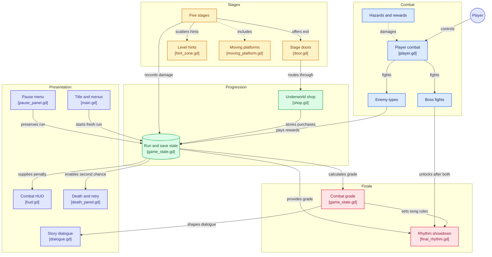

# Nate Hopkins vs. the Underworld

A 2D side-scrolling brawler/platformer in Godot 4.7 (GDScript). Fight through four levels and two bosses, then face a rhythm finale.

## Story

Nate Hopkins meets Hazel at a party and is dragged into the Underworld by Aphrodite. To return to the living world, he must fight through the Underworld, defeat the ghosts of his past relationships, and keep a beat.

## How to play (release)

Download `NateHopkins_v2.0.0_windows.zip` from https://github.com/nasiftahmid-ux/Nate_Hopkins_vs._the_Underworld/releases, unzip it, and double-click the .exe. No Godot needed. Keep all files together in one folder. If Windows shows "Windows protected your PC", click More info, then Run anyway.

## Build from source

1. Install Godot 4.7 or later.
2. Open `project.godot`.
3. Press F5 (main scene: `scenes/ui/intro.tscn`).

## Controls

| Action | Keys | Gamepad |
|---|---|---|
| Move | A / D or Arrow Keys | Left stick / D-pad |
| Jump | W / Up / Space | A / D-pad Up |
| Attack (combo) | J / Z | X |
| Kick (heavy) | K / X | Y |
| Special | L / C | RB / RT |
| Block | Q | LB / LT |
| Pause | Esc | Options / Start |

Kick unlocks at the boss 1 intro. Special unlocks after boss 1.

## Gameplay

- Run, jump, block, and chain a 4-hit ground combo, plus a kick, aerial slam, and cooldown-gated special move.
- Coins: picking up a coin gives +1 coin and +1s on the clock. Shop prices are in coins.
- Clock: the clock is your health. It drains 1s per second. Level and boss starts reset it to 60s. Entering the Negative World sets it to 25s. Negative levels started by clearing a previous negative level start at 30s. Kills, coins and boss hits add time. Boss hits add +5s (1s cooldown).
- Bosses: two bosses. Phases at 66% and 33% HP, second wind at 12% (heals to 25%), death at 1% HP. Committed attacks leave a 1.8x punish window. Boss 1 HP 900, boss 2 HP 1400.
- Negative World: when the clock hits 0 on a regular level, you enter a grayscale world with stronger enemies and 3x damage. Dying there returns you to the normal level with 60s. Boss clock-zero ends the run.
- Combat grade: after both bosses, the rhythm finale difficulty depends on damage taken across the run (FLAWLESS / CLEAN / BLOODIED / MANGLED).

## Enemies

- Basic Soul: walks at you and swings.
- Husk: fast swarmer.
- Blink Shade: teleports behind you.
- Cinder Imp: dodges sideways when you attack.
- Sorrow Knight: telegraphed melee, guards.
- Teardrop Shooter: keeps distance and fires shots.
- Time Leech: drains the clock up close.

## Shop

Aphrodite's shop appears between stages. One purchase per visit. Prices in coins, rising on repeat purchases.

| Item | Effect | Base price | Scale | Limit |
|---|---|---|---|---|
| Restore | Heal | 50 | x1.45 | blocked at full health |
| Warcry | +6 damage next stage | 120 | x1.40 | stacks |
| Swiftness | Special cooldown -0.25s | 180 | x1.70 | 4 ranks |
| Vitality | +10 max HP | 200 | x1.60 | stacks |
| Wrath | +3 heavy/slam/finisher damage | 220 | x1.60 | stacks |
| Second Chance | Cheat death once | 450 | x1.00 | once |

## Save

Three save slots in `user://saves/slot_N.json`. Start from the slot menu. Progress (level, coins, XP, defeated bosses, shop ranks) persists.

## Project structure

- `autoload/` - global singletons (GameState, InputSetup, audio).
- `scenes/` - player, enemies, bosses, levels, items, ui, dialogue.
- `_slice.gd` - headless atlas builder (run with `godot --headless --script res://_slice.gd`).

## Architecture

## Credits

Art, music and sound credits: TODO

## License

No license specified yet - all rights reserved. Contact the author before use.