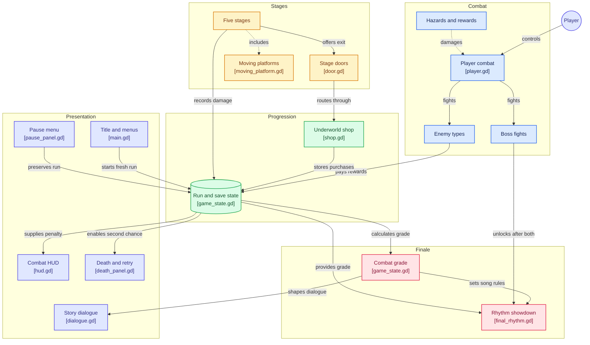

# Nate Hopkins vs. the Underworld

A 2D side-scrolling brawler/platformer built in **Godot 4.7 (GDScript)**. Fight your way through five levels of the Underworld, punch out a rogues' gallery of tormented souls, defeat two boss "exes," and prove your worth in a final rhythm-game showdown — all wrapped in a self-aware, comedic dating-sim story.

## Story

Nate Hopkins has a track record of breaking hearts. At a party, he meets Hazel — and immediately gets dragged into the Underworld by Aphrodite herself, who isn't about to let history repeat itself. To earn his way back to the world of the living (and a shot with Hazel), Nate has to fight through five levels of hell, defeat the ghosts of his past relationships, and finally prove he can keep a beat.

## Gameplay

- **Movement & combat:** Run, jump, block, and chain a 4-hit ground combo (punch → kick → punch → uppercut), plus a heavy attack, an aerial slam, and a cooldown-gated special move.
- **Enemies:** Four enemy types, each hand-animated, and each readable at a glance — every tell is painted into the sprite itself (posture, colour, direction) rather than hidden in a UI cue.
  - **Basic Soul** — walks straight at you and swings. It bobs at rest, leans into its run, and recoils when it eats a hit.
  - **Cinder Imp** — quick and twitchy, and it watches your attack state. Get aggressive near it and it flashes violet and slips sideways; the flash is the whole tell.
  - **Teardrop Shooter** — a caster that keeps its distance and fires a straight shot at wherever you were standing a moment ago, with a dedicated recoil animation that plays when you crowd it. How far it thinks it needs to stand is something you can see.
  - **Sorrow Knight** — the only enemy that guards, and its entire fight is a three-beat read painted onto its own body: it coils and stretches taller as its colour climbs from purple through amber, snaps to white on the impact frame with a fan of ground drawn across exactly where the blade will reach, then slumps grey and spends a moment spent. It only raises its guard while you are attacking it up close, and its guard stance is simply its idle pose tinted green.
- **Consistent animation:** Idle, run, attack, hurt and death play on every enemy, and each one changes direction by flipping its own art. Sprites are packed so the body sits on the node's centre line and every foot lands on one shared baseline — which means nothing shimmies, drifts, or turns inside out mid-fight, however often the direction changes.
- **Bosses:** A three-phase boss fight with a full attack-state machine, built around reading telegraphs and punishing recovery windows. Every phase shift is an invulnerable roar that clears the field.
  - **Phase I — 100% to 66%:** Hunting. Charge, slam, spit, and melee only. Reads like the original fight.
  - **Phase II — 66% to 33%:** The Tolling. Adds a lunging dash, a telegraphed ground-spike field, and a rapid barrage. Faster, +5 damage, +20 move speed, and can chain up to 2 attacks without a break.
  - **Phase III — 33% to 1%:** Berserk. The name turns to `THE ONE YOU HURT [ENRAGED]` and everything gets faster: an arm spiral that blankets the arena, an unblockable leaping execute that marks a landing strip, and decoy phantoms that fire while the real boss flanks. Chains of 3, shortest cooldowns in the fight.
  - **Punish windows:** Every committed attack leaves the boss open for `1.8x` damage — the fight is about spacing, not attrition.
  - **Second wind:** At 12% HP the boss roars, heals to 25%, and permanently gains damage and speed for the rest of the fight. It survives the first "kill" attempt by design.
  - **1% ending:** The boss only dies at 1% HP, clearing the arena and paying out its reward. Beating it unlocks the next fight — the second ex is tougher (more HP, +500 per previously defeated ex) and its defeat leads into the rhythm finale.
  - **Built-in fairness:** phase roars are invulnerable, the boss can't be knocked around or stood on by the player, and it can never be pushed out of the arena.
- **Rhythm finale:** After both bosses fall, prove yourself in a Guitar-Hero-style rhythm minigame — hit the right key (J / K / L) on the beat, with combo tracking and a miss-streak fail state.
- **Combat grades feed the finale:** How you fought the whole run decides how the final song treats you. Every stage (five levels plus both boss fights) records the damage you took; the total is measured against one full health bar per stage cleared, and each death costs an extra 10% of your clean-combat score. That produces a grade of **FLAWLESS**, **CLEAN**, **BLOODIED**, or **MANGLED**, which Aphrodite reads back at you before the song starts.

  | Grade | Clean score | Hit window | Notes | Misses allowed |
  |---|---|---|---|---|
  | FLAWLESS | `>= 0.85` | `1.35x` | `0.80x` | 4 |
  | CLEAN | `>= 0.65` | `1.20x` | `0.90x` | 3 |
  | BLOODIED | `>= 0.40` | `1.00x` | `1.00x` | 2 |
  | MANGLED | below | `0.80x` | `1.15x` | 2 |

  A flawless run gets a shorter, more forgiving song; a bad run gets more notes on a tighter clock with no extra slack. The grade is shown above the progress bar before the first note, Aphrodite's dialogue before the song and Hazel's reaction at the ending all react to it, so the finale is a verdict on the run rather than a fixed test. The thresholds and modifiers live in one table (`GRADE_TABLE` in `autoload/game_state.gd`) — edit them there to rebalance the whole system.
- **Aphrodite's Underworld Shop:** Every door out of a level routes through Aphrodite's shop before the next stage, and you get **one purchase per visit**. She has no interest in small talk. Prices climb each time you buy the same thing, so a second Vitality always costs more than the first, and the whole catalogue is tuned so a clean run barely breaks even.

  | Item | Effect | Base price | Scale | Limit |
  |---|---|---|---|---|
  | Restore | Full heal, right now | `50` | `x1.45` | blocked at full HP |
  | Warcry | `+6` damage on every attack, for the next stage only | `120` | `x1.40` | stacks |
  | Swiftness | Special move cooldown `-0.25s`, down to a `1.0s` floor | `180` | `x1.70` | 4 ranks |
  | Vitality | `+10` max HP, carried for the rest of the run | `200` | `x1.60` | stacks |
  | Wrath | `+3` damage on heavy attacks | `220` | `x1.60` | stacks |
  | Second Chance | Cheat death once per run: full heal and brief invulnerability instead of the death screen | `450` | — | once |

  Warcry is banked at the door and goes live when the next stage opens. It survives dying and retrying that stage, and it survives quitting and resuming, but it retires the moment you actually clear the stage — including a boss. Second Chance is spent the moment it saves you, and it does not count as a death, so it does not dock your clean-combat grade. Shop ranks, the banked Warcry, and any unused Second Chance all live in the save file, so quitting mid-run never costs you a purchase. The catalogue is a single table (`SHOP_ITEMS` in `autoload/game_state.gd`) — add or retune an entry there and the UI builds itself.
- **Progression:** Earn coins and XP from defeated enemies, level up to increase max HP, and unlock hints scattered through the levels. Progress persists between sessions (`GameState` writes to `user://save.json` on every payout) — returning to the title screen, dying, or quitting to the menu all keep your level, coins, XP, and defeated bosses. Max HP is derived from your level (`100 + 10` per level) plus whatever Vitality you bought, rather than stored, so it can never drift out of sync with your level. Pressing **Start** on the title screen deliberately begins a fresh run.
- **No-damage bonus:** Every hit you take during a level scales down your rewards. The XP multiplier is `1 - damage taken / max HP` (floor `x0.25`), and a level-up restores `50%` of max HP multiplied by that same factor — so a flawless clear pays full XP and a 50% heal, while a bad run earns as little as 25% XP and a 12.5% heal. The counter resets every time a level starts, and the HUD shows the live `XP x0.00 / HEAL 0%` penalty.
- **Gamepad support:** Full PlayStation and Xbox controller support, including in-game combat and menu navigation.

## Controls

| Action | Keys | PlayStation | Xbox |
|---|---|---|---|
| Move | `A` / `D` or Arrow Keys | Left Stick / D-pad | Left Stick / D-pad |
| Jump | `W` / `Up` / `Space` | ✕ (Cross) or D-pad Up | A or D-pad Up |
| Attack (combo) | `J` / `Z` | □ (Square) | X |
| Heavy Attack | `K` / `X` | △ (Triangle) | Y |
| Special | `L` / `C` | R1 or R2 | RB or RT |
| Block | `Q` | L1 or L2 | LB or LT |
| Pause | `Esc` | Options | Menu (Start) |

Controls are registered programmatically at startup (see `autoload/input_setup.gd`), so they're guaranteed to be consistent even if the project's Input Map is reset. Gamepads are supported for both PlayStation and Xbox pads — Godot's standard SDL layout is used, so any controller that follows either convention works, and menus are navigable with ✕/A (accept) and Options/Start (pause). Movement uses the left stick with a 0.25 deadzone, so small stick deflections are ignored, and block/special can be held on the analog triggers.

## Tech Stack

- **Engine:** [Godot 4.7](https://godotengine.org/)
- **Language:** GDScript
- **Architecture:**
  - `autoload/` — global singletons: `GameState` (persistent run data: HP, money, XP, level, per-stage and run-wide damage tracking, combat grading, dialogue/rhythm config, with JSON save/load to `user://save.json`) and `InputSetup` (keybinding registration).
  - `scenes/player/` — player movement, combat, and damage/death handling, plus the trauma-based directional camera shake attached to the player camera.
  - `scenes/enemies/` — enemy AI and combat behavior, all sharing the `EnemyBase` class, plus one generated `*_frames.tres` per enemy so each one's animation set is a data asset rather than hand-authored.
  - `scenes/bosses/` — boss fight state machine, boss arena, boss projectiles, and the rhythm-game finale.
  - `scenes/items/` — pickups and environmental hazards (coins, lava, spikes, falling rocks).
  - `scenes/levels/` — level scenes built on a shared parameterized `level_base.gd`, plus moving platforms and doors.
  - `scenes/ui/` — main menu, HUD, pause menu, and death screen.
  - `scenes/dialogue/` — a lightweight line-by-line dialogue/cutscene system.
  - `_slice.gd` — a headless atlas builder that turns the raw sprite sheets into lossless square-grid atlases plus `SpriteFrames` resources. It locates the labelled animation bands, strips the caption text (including captions fused to the first frame), and cuts frames on the widest internal gaps so particle trails and projectiles don't split a single pose in half. Every cell is then centred horizontally and bottom-aligned to one baseline, which is what makes flipping safe. Re-cut every enemy atlas from source with `godot --headless --script res://_slice.gd`.

### Architecture Diagram



## Download & Play

Pre-built Windows release: download the zip from the [Releases page](https://github.com/nasiftahmid-ux/Nate_Hopkins_vs._the_underworld/releases), extract, and run Nate Hopkins vs the Underworld.exe. No Godot install required.

Direct link (v1.0.0): https://github.com/nasiftahmid-ux/Nate_Hopkins_vs._the_underworld/releases/download/v1.0.0/Nate.Hopkins.vs.the.Underworld.zip
## Running the Project

1. Install [Godot 4.7](https://godotengine.org/download) or later.
2. Clone the repository:
   ```bash
   git clone https://github.com/nasiftahmid-ux/Nate_Hopkins_vs._the_underworld.git
   ```
3. Open Godot, choose **Import**, and select the `project.godot` file in the cloned folder.
4. Press **Play** (or `F5`) to run the game.


## Project Status

This is an actively developed solo project. Recent work: Aphrodite's Underworld Shop now sits between every level — each door routes through her shop for a single purchase, and coins buy a real choice between six escalating upgrades (Warcry damage for the next stage, special-move cooldown, max HP, heavy-attack damage, an immediate full heal, or one cheat death per run), with prices that scale on every repeat purchase and are tuned so a clean run barely breaks even; shop ranks, banked Warcry, and any unused Second Chance all persist in the save file, and Warcry survives dying or quitting but retires the moment a stage is genuinely cleared, bosses included; screen shake is now trauma-based and damage-scaled — the player camera owns a trauma value that decays each frame with squared falloff, and hits push trauma in proportion to how hard they actually landed against the player's health pool (a quarter of the health bar is a full-intensity hit, so a cinder imp tap and a boss execute feel nothing alike, and the same damage hits quieter as your max HP grows), with the shake biased along the impact axis so side hits read sideways and slams read vertical; damage sources pass their own world position, the player's own attacks get a deliberately quieter impact kick, and the boss's old fixed-amplitude random tween is gone, so a flurry of light hits can no longer stack into a white-out; the rhythm finale was made a verdict on the run instead of a fixed test — `GameState` now records damage per stage and across the whole run, grades the fight as FLAWLESS/CLEAN/BLOODIED/MANGLED, and applies that grade to the finale's hit window, note count, and miss tolerance, with Aphrodite calling out your performance before the song and Hazel reacting to it at the ending; the boss fight was rebuilt into a three-phase soulslike encounter — split into equal thirds with a distinct moveset per phase (lunge, spike field, and barrage at 66%; spiral, unblockable leaping execute, and decoy phantoms at 33%), `1.8x` punish windows after every committed attack, an invulnerable roar plus permanent stat boost on a second wind at 12% HP, and a 1% HP ending that clears the arena and unlocks the next fight; controller support was added — PlayStation and Xbox pads now drive every action (left stick or D-pad movement, face buttons for jump/light/heavy, shoulder buttons or analog triggers for special/block, and Start for pause), with menus wired to the same layout; a damage-based reward penalty was added — taking hits during a level scales down the XP from further kills and the HP restored on level-up, rewarding clean runs (level-up healing now also applies to the live player HP instead of only the stored value); enemy and level scripts were refactored into shared base classes (`EnemyBase` and `level_base.gd`, reducing duplicated logic across all levels); and a persistent save/load system was added (`GameState` writes progress to `user://save.json`), which now actually survives quitting — the title screen, death screen, and quit-to-menu no longer reset the run, and max HP is derived from level instead of drifting out of sync. The enemy roster was then given real animation: all four enemies now have hand-built atlases with idle, run, attack, hurt and death, plus a signature per enemy — the cinder imp's violet dodge slip, the shooter's recoil when crowded, and the Sorrow Knight's full telegraph, which climbs its own body from purple through amber to white across a windup, strike and grey recovery instead of leaning on a UI warning. Those atlases are cut losslessly from the source sheets by a headless builder, so any pose can be re-cut later without hand-editing a single rectangle. Future focus areas include deeper content — new enemy types, more boss attacks, and level polish.

## License

No license has been specified yet — all rights reserved by default. If you'd like to use or build on this project, please reach out first.